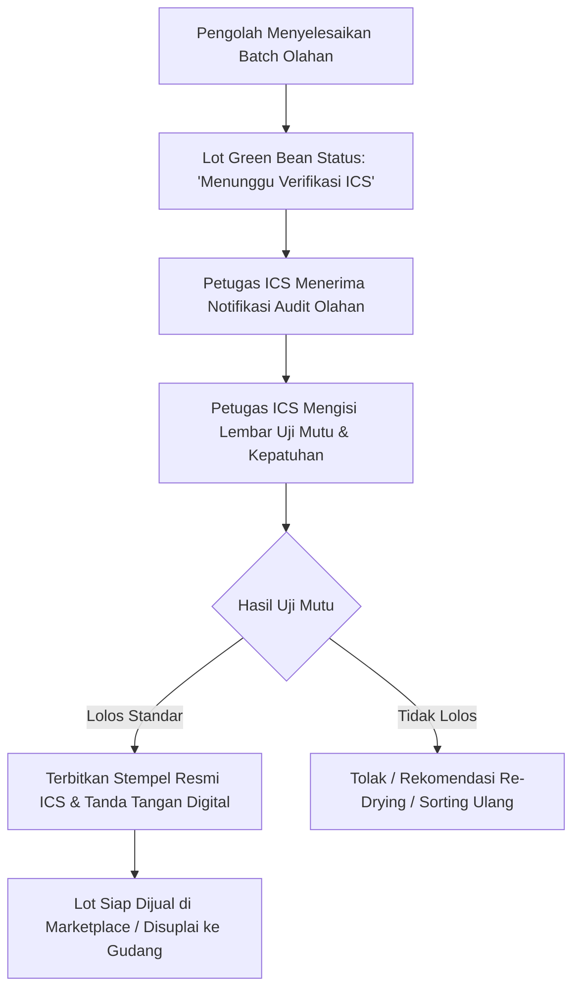

# 📋 DOKUMEN PERENCANAAN TEKNIS & ARSITEKTUR: 4 FITUR REVISI
**Proyek**: Circular Coffee Trace (CCT) & CircularTrace Ecosystem  
**Dasar Kebutuhan**: Hasil Meeting Evaluasi User & QA (Nov 2026)  
**Tujuan Dokumen**: Panduan implementasi terperinci yang siap dibagikan (*copy-paste ready*) ke berbagai ruang percakapan/agent developer.  

---

## 📑 DAFTAR ISI PAKET PEKERJAAN
1. [Paket 1: Sistem Registrasi & Login Realtime (Email Verification Link & Penyesuaian Role)](#-paket-1-sistem-registrasi--login-realtime-email-verification-link--penyesuaian-role)
2. [Paket 2: Panel Super Admin Circular Trace (Kelola Paket Layanan & Harga Fitur)](#-paket-2-panel-super-admin-circular-trace-kelola-paket-layanan--harga-fitur)
3. [Paket 3: Verifikasi Hasil Olahan Pengolah oleh Petugas ICS Kelompok Tani](#-paket-3-verifikasi-hasil-olahan-pengolah-oleh-petugas-ics-kelompok-tani)
4. [Paket 4: Perbaikan Fitur Cetak Blanko A4 (Isolasi Lembar Kerja Fisik Profesional)](#-paket-4-perbaikan-fitur-cetak-blanko-a4-isolasi-lembar-kerja-fisik-profesional)

---

---

## 🚀 PAKET 1: Sistem Registrasi & Login Realtime (Email Verification Link & Penyesuaian Role)

### 1.1 Latar Belakang & Kebutuhan
* **Alur Saat Ini**: User mendaftar langsung aktif atau verifikasi manual admin tanpa konfirmasi kepemilikan email secara instan.
* **Kebutuhan Baru**:
  1. **Alur Realtime**: User mengisi form pendaftaran &rarr; Sistem memvalidasi input &rarr; Sistem mengirim email verifikasi bertautan unik ke alamat email pendaftar &rarr; Pendaftar membuka email dan mengklik tautan verifikasi (`https://circularcoffee.circulartrace.id/verify-email?token=...`) &rarr; Akun otomatis terverifikasi dan pengguna langsung ter-login (*auto-login*) masuk ke dashboard.
  2. **Penyesuaian Opsi Pendaftaran Publik**: Karena **Petani** dan **Pengolah (Wet Mill internal)** sudah berada di bawah naungan **Kelompok Tani**, opsi pendaftaran publik disesuaikan agar tidak membingungkan petani perorangan.

### 1.2 Rekomendasi SMTP Service Provider
Berdasarkan kebutuhan verifikasi email realtime yang cepat dan andal:

| Provider | Kelebihan | Kekurangan | Rekomendasi |
| :--- | :--- | :--- | :--- |
| **Resend** (*resend.com*) | • Sangat cepat (delay < 1 detik)<br>• Tier gratis 3.000 email/bulan<br>• Tidak diblokir port hosting/cPanel<br>• API modern + fallback SMTP | Perlu setting DNS (DKIM/SPF) di domain | ⭐ **Pilihan Utama (Sangat Disarankan)** |
| **Brevo / Sendinblue** | • 300 email gratis per hari<br>• Dukungan SMTP TLS standar port 587<br>• Reputasi IP pengiriman tinggi | Setup antarmuka awal sedikit lebih kompleks | ⭐ **Pilihan Alternatif Terbaik** |
| **cPanel Webmail SMTP** (`mail.circulartrace.id`) | • Sudah tersedia di hosting cPanel Rumahweb<br>• Tanpa biaya langganan pihak ketiga | • Port 465/587 terkadang dibatasi di shared hosting<br>• Rawan masuk folder spam jika skor IP shared turun | Digunakan sebagai opsi cadangan/internal |

> [!TIP]
> **Rekomendasi Implementasi**: Gunakan **Resend** atau **Brevo** melalui library PHP/HTTP REST endpoint di `public/api/mailer.php`. Jika kredensial belum diisi, sediakan mode simulasi dev di layar response agar developer lokal tetap bisa memverifikasi akun tanpa menunggu email.

### 1.3 Penyesuaian Opsi Registrasi Role
Karena Petani dan Pengolah dicakup oleh Kelompok Tani:
* **Peran yang Terbuka untuk Registrasi Publik Mandiri**:
  1. `admin_kelompok_tani`: Pengurus / Ketua Gabungan Kelompok Tani (Penaung Petani & Pengolah).
  2. `gudang`: Pengelola Gudang Green Bean Komersial & Ekspor.
  3. `roaster`: Pelaku Artisan Roastery & Coffee Lab.
  4. `cafe`: Pemilik Coffee Shop & Barista Ritel.
  5. `verifikator`: Dewan Sertifikasi & Q-Grader Independen.
* **Peran Petani & Pengolah**:
  * Ditambahkan keterangan: *"Untuk Petani Kopi dan Operator Pengolah, pendaftaran dan alokasi akun dikelola langsung melalui portal Kelompok Tani / Gapoktan binaan."*
  * Jika pendaftar tetap memilih Petani, wajib mencantumkan Kelompok Tani penaung (seperti yang sudah dibangun).

### 1.4 Spesifikasi Teknis & Berkas Target
* **Tabel Database**:
  * Tambah kolom di tabel `users`:
    * `email_verification_token` VARCHAR(64) NULL
    * `email_verification_expires_at` DATETIME NULL
    * `is_email_verified` TINYINT(1) DEFAULT 0
* **API Backend**:
  * `public/api/auth.php`:
    * Action `register`: Generate token `bin2hex(random_bytes(32))`, masa berlaku 24 jam. Kirim email template HTML berisi tombol verifikasi.
    * Action `verify-email`: Menerima `token`, validasi kecocokan dan masa berlaku. Update `is_email_verified = 1`, set status aktif, kembalikan auth token / session user untuk auto-login.
  * `public/api/mailer.php`: Implementasi fungsi pengiriman template email HTML verifikasi resmi berlogo CircularCoffee.
* **Frontend**:
  * `src/components/RegisterModal.tsx`: Penyesuaian opsi peran dan tampilan state pendaftaran berhasil (*"Silakan periksa kotak masuk email Anda untuk mengaktifkan akun"*).
  * `src/pages/VerifyEmailPage.tsx` (Halaman Baru): Menangkap query parameter `?token=...`, memanggil API `verify-email`, menampilkan animasi sukses, dan mengarahkan langsung ke dashboard tanpa perlu input password lagi.
  * `src/App.tsx`: Daftarkan rute `/verify-email`.

---

---

## 🛠️ PAKET 2: Panel Super Admin Circular Trace (Kelola Paket Layanan & Harga Fitur)

### 2.1 Latar Belakang & Kebutuhan
* **Kebutuhan**: Panel khusus pemilik/pengelola platform CircularTrace (*Super Admin / Platform Admin*) untuk mengatur paket langganan komersial (*Service Packages / Subscriptions*) yang akan dijual ke para pelaku rantai pasok kopi (Kelompok Tani, Roastery, Gudang, Cafe).
* **Fitur Utama**:
  1. Pengaturan nama paket & target stakeholder (misal: *Paket Starter Gapoktan*, *Paket Roastery Pro*, *Paket Enterprise Ekspor*).
  2. Pengaturan harga (Harga bulanan, harga tahunan, diskon).
  3. Matriks fitur per paket (Toggle fitur ON/OFF, pembatasan kuota lot panen, kuota cetak barcode QR, integrasi AI cupping, dll.).
  4. Pengelolaan status aktif/non-aktif paket dan pesanan pelanggan.

### 2.2 Desain Arsitektur Data
* **Tabel Baru `service_packages`**:
  * `id`: VARCHAR(64) PRIMARY KEY (e.g. `PKG-GAPOKTAN-PRO`)
  * `name`: VARCHAR(150) (e.g. *Paket Kelompok Tani Mandiri*)
  * `target_role`: ENUM (`admin_kelompok_tani`, `roaster`, `gudang`, `cafe`, `all`)
  * `price_monthly`: DECIMAL(12,2)
  * `price_yearly`: DECIMAL(12,2)
  * `discount_percent`: INT DEFAULT 0
  * `features_json`: JSON (Daftar fitur, batas kuota, akses modul)
  * `is_popular`: TINYINT(1) DEFAULT 0
  * `status`: ENUM (`active`, `archived`)
* **Daftar Fitur yang Dapat Ditoggle (Feature Flags)**:
  * Batas Kuota Lot Panen / Batch Sangrai (e.g. Unlimited atau 50 lot/bulan)
  * Fitur Peta Poligon Lahan EUDR & GPS Geolocation
  * Fitur AI Spider Radar Cupping & Agtron Roasting
  * Cetak Label QR Traceability & Kustomisasi Branding Logo
  * Akses Marketplace B2B & Fitur Penjualan Ceri / Green Bean
  * Dukungan Integrasi API Eksternal

### 2.3 Spesifikasi Teknis & Berkas Target
* **Backend**:
  * `public/api/packages.php` (Baru): Endpoint CRUD paket layanan (`GET`, `POST`, `PUT`, `DELETE`).
  * `database/schema.sql` & `scripts/build_sqlite_db.php`: Skema tabel `service_packages`.
* **Frontend**:
  * `src/pages/admin/superadmin/PlatformPackagesPage.tsx` (Baru):
    * Kartu statistik paket aktif & ringkasan pendapatan.
    * Grid / Tabel paket langganan dengan toggle aktifasi cepat.
    * Modal Tambah & Ubah Paket: Form nama paket, harga bulanan/tahunan, badge promosi, checklist fitur interaktif.
  * `src/components/adminlte/AdminLTESidebar.tsx`:
    * Tambahkan navigasi menu khusus jika `currentUser.role === 'super_admin'` &rarr; `Master Paket Layanan & Harga`.
  * `src/types/coffee.ts`: Definisi interface `ServicePackage` dan `PackageFeatureItem`.

---

---

## 🔍 PAKET 3: Verifikasi Hasil Olahan Pengolah oleh Petugas ICS Kelompok Tani

### 3.1 Latar Belakang & Kebutuhan
* **Kondisi Saat Ini**: Petugas ICS (Internal Control System) di kelompok tani baru memverifikasi data petani, lahan kebun (EUDR), dan hasil panen ceri segar.
* **Kebutuhan Baru**: Petugas ICS harus memiliki otoritas dan lembar audit digital untuk **memverifikasi hasil olahan kopi yang diproduksi oleh Stasiun Pengolah (Wet Mill internal)** sebelum green bean tersebut dijual ke marketplace atau dikirim ke gudang ekspor.
* **Parameter Verifikasi Olahan Pengolah**:
  1. Keabsahan metode fermentasi (Washed, Natural, Honey, Anaerob, Carbonic Maceration).
  2. Lama waktu fermentasi dan kepatuhan sanitasi/kebersihan tangki.
  3. Uji kadar air (*Moisture Content*, standar 10% - 12%) dan uji kadar air aktif (*Water Activity Aw*).
  4. Uji fisik defect green bean (Defect primer & sekunder sesuai standar SNI / SCA).
  5. Perhitungan persentase rendemen (*yield cherry-to-green bean ratio*).

### 3.2 Alur Kerja (Workflow)


### 3.3 Spesifikasi Teknis & Berkas Target
* **Database & Tipe Data**:
  * Update `processed_green_bean_lots` (dan tabel terkait di API):
    * `ics_verification_status`: `'unverified' | 'pending' | 'verified' | 'rejected'`
    * `ics_verifier_id`: ID petugas ICS yang melakukan verifikasi
    * `ics_verified_at`: Tanggal/waktu verifikasi
    * `ics_notes`: Catatan audit mutu olahan
    * `ics_stamp_id`: Referensi ke `verification_stamps`
* **Frontend**:
  * `src/pages/admin/ict/IctGreenBeanAuditPage.tsx` (Baru atau terintegrasi di modul ICT):
    * Tab daftar lot olahan pengolah yang menunggu verifikasi.
    * Modal Formulir Uji Mutu Olahan ICS (Input kadar air, nilai defect, metode olah, catatan kesesuaian batch).
    * Tombol aksi: `[✓ Terbitkan Sertifikasi Mutu ICS]` dan `[✕ Minta Pengeringan / Sortasi Ulang]`.
  * `src/context/CoffeeContext.tsx`:
    * Fungsi `verifyProcessedLotByICS(lotId, approved, inspectionData)`.
  * `src/components/processor/ProcessedLotsView.tsx`:
    * Tampilkan badge status verifikasi ICS pada setiap kartu/baris lot green bean.

---

---

## 🖨️ PAKET 4: Perbaikan Fitur Cetak Blanko A4 (Isolasi Lembar Kerja Fisik Profesional)

### 4.1 Masalah Saat Ini
* Ketika pengguna menekan tombol **"Cetak Formulir A4"** atau ikon printer pada blanko formulir fisik lapangan, tampilan web (sidebar AdminLTE, tombol navbar, tombol navigasi, background gelap, kartu modal) ikut masuk ke dalam hasil print atau pratinjau cetak (*print preview*).
* Dokumen cetak tampak berantakan, tidak berformat lembar kerja resmi, dan tidak siap digunakan petugas lapangan.

### 4.2 Standar Hasil yang Diharapkan
1. **Hanya Formulir yang Tercetak**: Semua elemen UI web (sidebar, navbar, header, tombol print/tutup, backdrop modal, pagination) harus 100% lenyap saat masuk mode cetak.
2. **Format Lembar Kerja Resmi A4**:
   * Ukuran kertas presisi: `@page { size: A4 portrait; margin: 12mm 15mm; }`.
   * Kop surat formal (Header resmi CircularTrace / Gabungan Kelompok Tani dengan logo dan nomor dokumen SK).
   * Kotak isian bergaris tegas (*crisp 1px black border*) untuk diisi bolpoin oleh petugas lapangan.
   * Tabel checklist inspeksi lapangan (kondisi cuaca, ketinggian mdpl, koordinat GPS patok batas, brix ceri, pH air fermentasi, kadar air).
   * Kolom tanda tangan resmi: Tanda Tangan Petani, Petugas ICS, dan Ketua Kelompok Tani.
   * QR Code verifikasi blanko resmi di pojok dokumen.

### 4.3 Spesifikasi Teknis & Solusi Kode
* **CSS Print Isolation (`src/index.css` atau dedicated stylesheet)**:
  ```css
  @media print {
    /* 1. Sembunyikan seluruh antarmuka web */
    body * {
      visibility: hidden;
    }
    nav, aside, header, footer, button, .no-print, [role="navigation"] {
      display: none !important;
    }

    /* 2. Hanya tampilkan kontainer blanko dokumen target */
    #printable-blanko-document, #printable-blanko-document * {
      visibility: visible;
    }

    #printable-blanko-document {
      position: absolute;
      left: 0;
      top: 0;
      width: 100%;
      margin: 0;
      padding: 0;
      background: white !important;
      color: black !important;
      box-shadow: none !important;
      border: none !important;
    }

    @page {
      size: A4 portrait;
      margin: 12mm 15mm;
    }
  }
  ```
* **Berkas Target**:
  * `src/components/shared/BlankoFormulirModal.tsx`:
    * Beri pembungkus dokumen ID `#printable-blanko-document`.
    * Beri kelas `.no-print` pada tombol `Cetak Dokumen`, tombol `Tutup`, dan header kontrol modal.
    * Desain ulang lembar kerja untuk 4 varian form (Petani, Pengolah, Gudang, Roastery) agar tata letaknya padat, proporsional persis 1 lembar halaman A4 (tidak terpotong ke halaman 2).
  * `src/index.css`: Pastikan aturan `@media print` terdefinisi secara global tanpa ditimpa oleh styling Tailwind `@media screen`.

---

---

## 📌 PANDUAN PEMBAGIAN TUGAS (TASK ASSIGNMENT)

| Paket | Nama Fitur | Target Repositori & Modul | Prioritas | Estimasi Kompleksitas |
| :---: | :--- | :--- | :---: | :---: |
| **Paket 1** | Registrasi Realtime Email Verification & Penyesuaian Role | CCT-coffee: `auth.php`, `mailer.php`, `RegisterModal.tsx`, `VerifyEmailPage.tsx` | Tinggi | Menengah |
| **Paket 2** | Super Admin CircularTrace (Paket Layanan & Harga) | CCT-coffee & Marketplace: `packages.php`, `PlatformPackagesPage.tsx`, Sidebar | Sedang | Menengah - Tinggi |
| **Paket 3** | Verifikasi ICS untuk Lot Olahan Pengolah | CCT-coffee: Modul ICT, `CoffeeContext.tsx`, `ProcessedLotsView.tsx` | Tinggi | Menengah |
| **Paket 4** | Perbaikan Print A4 Blanko Fisik Profesional | CCT-coffee: `BlankoFormulirModal.tsx`, `index.css` | Sangat Tinggi | Cepat & Fokus |

> **Catatan Penggunaan**: Dokumen ini dapat langsung disalin per bagian (misalnya hanya bagian **Paket 4** atau **Paket 1**) ke dalam prompt developer/chat terpisah untuk pengerjaan paralel tanpa tumpang tindih logika.
